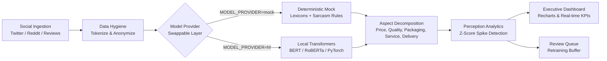

<div align="center">

# ⚡ SentimentIQ: Social Media Sentiment Intelligence
### *Product Perception Modeling & Anomaly Spike Detection System*

[](https://opensource.org/licenses/MIT)
[](https://fastapi.tiangolo.com/)
[](https://react.dev/)
[](https://tailwindcss.com/)
[](https://frontend-ten-beta-q9ylc6x88t.vercel.app)
[](https://www.docker.com/)

**Academic Capstone Project: B.E. (Artificial Intelligence & Machine Learning)**  
*Transforming noisy, unstructured social media feeds into actionable product perception intelligence with multi-aspect decomposition and statistical spike alerting.*

---

### 🌐 [Live Production Demo](https://frontend-ten-beta-q9ylc6x88t.vercel.app) • 📖 [API Documentation (Swagger)](http://localhost:8000/docs)

</div>

---

## 🌟 Executive Summary

Modern consumer feedback is fast, nuanced, and distributed across platforms like Twitter/X, Reddit, and product review hubs. Simple binary polarity models fail when a customer says:  
> *"The phone build quality is flawless, but customer service was awful and shipping took 3 weeks."*

**SentimentIQ** bridges this gap by combining:
1. **Calibrated Polarity & Sarcasm Classification**: Extracts negative, neutral, and positive probabilities with uncertainty thresholds and sarcasm flags.
2. **Decomposed Multi-Aspect Extraction**: Assesses granular sentiment across 5 key dimensions: **Price**, **Quality**, **Packaging**, **Service**, and **Delivery**.
3. **Statistical Anomaly Spike Alerts**: Continuously tracks sentiment trajectories using $Z$-score statistical thresholds ($Z \ge 2.5\sigma$) to identify PR and product crises before they escalate.
4. **Human-in-the-Loop Active Retraining**: A dedicated review queue allowing domain specialists to correct ambiguous predictions with one click, preserving ground truth labels for future model retraining.
5. **Swappable Model Architecture**: Zero downtime model swapping (`MODEL_PROVIDER=mock|hf`) to transition seamlessly from rule-based lexicons to fine-tuned transformer weights (BERT / RoBERTa).

---

## 🖥️ System Architecture & Pipeline



---

## ✨ Core Features & Pages

| Page | Description | Key Capabilities |
| :--- | :--- | :--- |
| **🚀 Landing Page** | Public front door | Value proposition, architecture pipeline diagram, call-to-actions. |
| **⚡ Live Analyzer** | Instant inference | Test any post, interactive example cards, calibrated probability bars, sarcasm warning, 5 aspect polarity chips. |
| **📊 Perception Dashboard** | Executive analytics | Real-time KPI cards, Perception Impact Score gauge ($0-100$), Recharts 30-day temporal trend lines, aspect stacked bars. |
| **🚨 Spike Alerts** | Anomaly monitoring | $Z$-score spike detection table with plain-English causal root-cause explanations and status controls (`Open`, `Acknowledged`, `Closed`). |
| **🏷️ Review Queue** | Human-in-the-loop | Queue of ambiguous ($<65\%$ confidence) and sarcasm-flagged posts with one-click relabeling for future fine-tuning. |
| **📁 Batch CSV Analysis** | Bulk inference | Upload `.csv` up to 2MB, pre-built 1-click sample dataset, live preview table, and enriched CSV export. |
| **⚖️ Brand Compare** | Competitive analysis | Benchmark 2-4 brands side-by-side with interactive Radar charts and volume share distributions. |
| **📚 Methodology & About** | Technical documentation | Compares Baseline, Bi-LSTM, and Transformer models, with ethical data hygiene and a clearly marked placeholder for measured test results. |
| **🔐 Authentication** | Security layer | JWT-based auth protecting operational views (`demo@sentimentiq.ai` / `demo1234`). |

---

## 🛠️ Tech Stack

### Frontend
- **Framework**: [React 19](https://react.dev/) + [Vite](https://vitejs.dev/) + [TypeScript](https://www.typescriptlang.org/)
- **Styling**: [Tailwind CSS 3.4](https://tailwindcss.com/) with dark/light mode toggle
- **Charts & Visuals**: [Recharts](https://recharts.org/) (Line, Stacked Bar, Radar diagrams)
- **Icons**: [Lucide React](https://lucide.dev/)
- **Deployment**: [Vercel](https://vercel.com/)

### Backend
- **Framework**: [FastAPI](https://fastapi.tiangolo.com/) (Python 3.11 / 3.13)
- **Validation**: [Pydantic v2](https://docs.pydantic.dev/)
- **ORM & Migrations**: [SQLAlchemy 2.0](https://www.sqlalchemy.org/) + [Alembic](https://alembic.sqlalchemy.org/)
- **Database**: PostgreSQL (production) / SQLite (zero-config local dev)
- **Security & Rate Limiting**: [SlowAPI](https://github.com/laurentS/slowapi) (60 req/min on `/api/predict`), `python-jose`, `passlib` (bcrypt)
- **Testing**: [pytest](https://docs.pytest.org/) test suite

---

## 🚀 Quick Start Guide

### Option 1: Docker Compose (One-Command Deployment)

Run PostgreSQL, FastAPI, and the React Frontend simultaneously:

```bash
docker-compose up --build
```
- **Web App**: `http://localhost:3000`
- **FastAPI Backend**: `http://localhost:8000/docs`

---

### Option 2: Local Development Setup

#### 1. Backend Setup
```bash
cd backend

# Create virtual environment
python -m venv venv

# Activate virtual environment
# Windows:
.\venv\Scripts\activate
# Linux/macOS:
source venv/bin/activate

# Install dependencies
pip install -r requirements.txt

# Run migrations & seed 30 days of synthetic demo data
alembic upgrade head
python -m app.services.seed_data

# Start FastAPI server
uvicorn app.main:app --reload --port 8000
```
API Documentation will be live at `http://localhost:8000/docs`.

#### 2. Frontend Setup
```bash
cd frontend

# Install packages
npm install

# Start development server
npm run dev
```
Open **`http://localhost:5173`** in your browser.

---

## 🔑 Demo Credentials

To access protected operational pages (Dashboard, Alerts, Review Queue, Batch Analysis):

| Field | Value |
| :--- | :--- |
| **Email** | `demo@sentimentiq.ai` |
| **Password** | `demo1234` |

*(Note: Landing, Live Analyzer, Brand Compare, and Methodology pages are publicly accessible without signing in).*

---

## 🔄 Swapping to Custom Trained HuggingFace Model

The backend incorporates an abstracted `ModelProvider` layer. To deploy your trained PyTorch / HuggingFace model weights:

1. Place your model files into the directory specified by `MODEL_DIR`:
   ```text
   saved_models/sentiment_model/
   ├── config.json
   ├── pytorch_model.bin  (or model.safetensors)
   ├── tokenizer.json
   └── vocab.txt
   ```
2. Update your `backend/.env` file:
   ```env
   MODEL_PROVIDER=hf
   MODEL_DIR=./saved_models/sentiment_model
   ```
3. Restart the backend. The UI badge in the footer will automatically update from `Model: mock (demo)` to `Model: HuggingFace (sentiment_model)`.

---

## 🧪 Testing

Run automated tests to verify API contracts, confidence calibration, and aspect extraction:

```bash
cd backend
python -m pytest -v tests
```

---

## 📜 Ethical Compliance & Data Privacy
- **Public Data Only**: Inference and analytics are conducted solely on publicly available social posts and product reviews.
- **Anonymization**: User handles, personal identifiers, and private metadata are stripped prior to model inference and database persistence.
- **No Invented Metrics**: Academic integrity is upheld by preserving empirical test placeholders until final model weights are measured and published.

---

<div align="center">
  <sub>Developed for B.E. (AI & ML) Capstone Project • 2026 Academic Research</sub>
</div>
